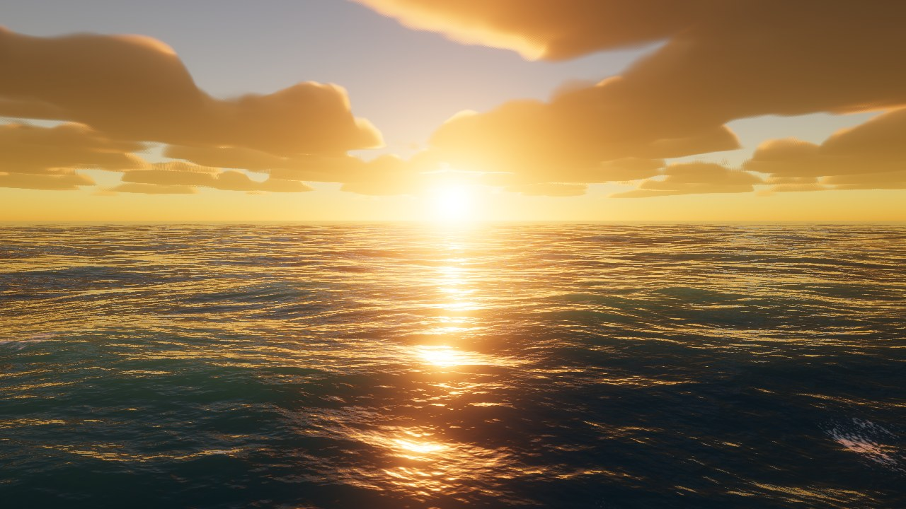
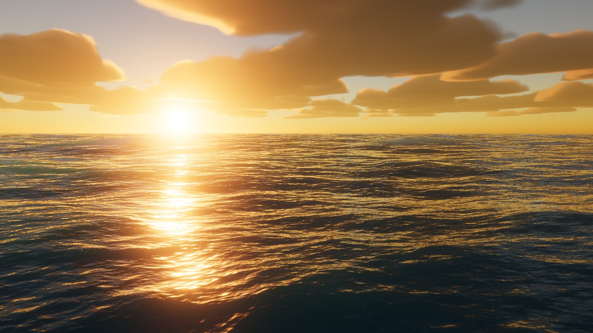
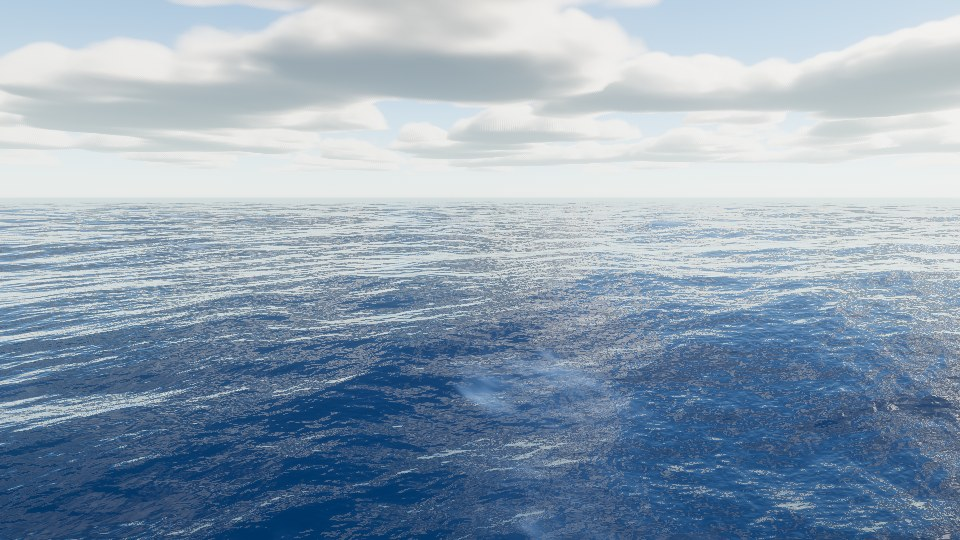

# WebGPU Ocean

ゲームエンジンも描画ライブラリも使わず、**ブラウザの WebGPU だけ**で動くリアルタイムの海です。
元記事のリポジトリ（MIT）のコードは参照せず、記事に書かれた機能リストだけを仕様として一から実装しました。



| 強風 (14 m/s) の白波 | 昼の太陽 |
|---|---|
|  |  |

## 動かし方

WebGPU 対応ブラウザ（Chrome / Edge 113 以降など）で `index.html` を開きます。ES Modules を使うので静的サーバ経由で開いてください。

```sh
python3 -m http.server 8000
# → http://localhost:8000/
```

ビルド工程も依存パッケージもありません（GitHub Pages などにそのまま置けます）。

### 操作

| 操作 | キー |
|---|---|
| 移動 | `W` `A` `S` `D`（矢印キーも可） |
| 上昇 / 下降 | `Space` / `E`、`Q` / `C` |
| 加速 | `Shift` |
| 視点 | ドラッグ（ダブルクリックでマウスロック） |
| 移動速度 | ホイール |
| パネル表示切替 | `H` |

右上のパネルで風速・風向・波の鋭さ・白波・太陽の高度と方位・雲量・露出・ブルーム・時間速度を変えられます。

URL パラメータで状態を固定できます（スクリーンショット比較用）。
例: `?t=30&cam=0,7,0,20,-4&sun=2,20&wind=14&ui=0&scale=1`

## 記事の機能リストとの対応

| 記事の項目 | 実装 |
|---|---|
| 細かい波の揺れを計算で再現 | JONSWAP スペクトル + 方向分布 → GPU 上の逆 FFT（256²、3 カスケード）。波長約 7 cm〜数百 m を 1 フレームで合成 |
| 波頭に立つ白波 | 水平変位のヤコビアンで波頭の圧縮/折り返しを検出 → 減衰しながら残る泡バッファ + セル状ノイズでしきい値処理 |
| 夕日が水面に落とすきらめき | GGX スペキュラ（画素の大きさに応じて粗さを広げる）+ Karis 平均付きのブルーム |
| 雲が流れる夕焼け空 | Rayleigh/Mie/オゾンの大気散乱 LUT + 2D カバレッジ + 3D Worley 侵食のボリューム雲（風で流れる） |
| WASD で自由に飛べるカメラ | 慣性付きフライカメラ（`src/camera.js`） |
| エンジン・ライブラリ不使用 | 依存ゼロ。行列計算も自前（`src/math.js`） |

## 仕組み

```
毎フレーム
 ├─ compute: 海洋シミュレーション (src/ocean.js)
 │    h(k,t) の時間発展 → Stockham 逆 FFT 16 パス → 変位/微分テクスチャ + 泡 → ミップ生成
 ├─ compute: 空 (src/sky.js)
 │    大気散乱 LUT (256×128) → 雲込みの反射用環境マップ (1024×256) + 太陽の雲による遮蔽率
 ├─ render (4x MSAA, HDR, reversed-Z)
 │    海面: カメラ中心の極座標メッシュ、頂点シェーダで変位、フラグメントで法線/反射/スペキュラ/SSS/白波/霞
 │    空:   大気 LUT + 太陽 + ボリューム雲 (深度が空いている画素だけ)
 └─ post (src/post.js): ブルーム (13 タップ縮小 / テント拡大) → ACES トーンマップ → sRGB
```

- **3 カスケード**（256 m / 48 m / 9 m）が波数帯を分担するので同じ波長を二重に数えません。分散関係を `2π/600s` で量子化しているので、600 秒で継ぎ目なくループします。
- 波高はスペクトルから物理的に決まります。GPU から読み戻した値は、風速 9 m/s で有義波高 ≈ 2.1 m、15 m/s で ≈ 3.5 m（`tools/simstats.html`）。
- 海面メッシュは同心リング（513×513 頂点）で、外側ほど間隔が指数的に広がります。頂点の間隔に合わせたミップレベルで変位をサンプリングするので、遠くの波がちらつきません。

## 「撮る係」と「直す係」のループ

記事にあった「Claude が画面を撮り、別の係が批評して直す」流れは、ヘッドレス Chromium（SwiftShader の WebGPU）で再現できます。

```sh
python3 -m http.server 8000 &
node tools/shot.mjs out.png "t=30&ui=0&cam=0,7,0,120,12" 4
```

今回の開発でも、撮影 → 批評 → 修正を十数回まわしました。主な修正は次のとおりです。

1. 露出が約 6 倍高く画面が真っ白 → 露出の既定値と大気の多重散乱項を調整
2. 雲がほぼ見えない → カバレッジしきい値を修正
3. 雲に縦の筋とゴースト → 2D ノイズを厚みのある層に押し出していたのが原因。3D Worley 侵食とドーム状の高さしきい値に変更し、距離に応じた LOD も追加
4. 強風でも白波が出ない → GPU から読み戻して確認したところ、ヤコビアンの最小値が 0.57 前後で、しきい値 0.45 に一度も届いていなかった → しきい値を再調整
5. 白波が丸い点やぼやけた染みになる → 大きい波のカスケードを重視し、風下方向に伸ばした模様、セル状ノイズのしきい値処理、Lambert 照明に変更
6. 太陽が雲に隠れてきらめきが弱い → 地平線に向かって雲を薄くし、夕日が雲の下に覗く構図に

## ファイル構成

```
index.html          UI とエントリポイント
src/main.js         初期化・メインループ・UI
src/ocean.js        FFT 海洋シミュレーション (compute)
src/oceanRender.js  海面メッシュとシェーディング
src/sky.js          大気散乱・雲・環境マップ
src/post.js         ブルーム・トーンマップ
src/camera.js       フライカメラ
src/math.js         行列ユーティリティ
src/common.js       共通 WGSL / バインドグループ補助
tools/shot.mjs      ヘッドレス撮影スクリプト
tools/simstats.html シミュレーション統計の読み戻し (デバッグ用)
```

## 既知の制限と今後

- 雲は 1 画素あたり 40 ステップのレイマーチです。内蔵 GPU で重い場合は `?scale=0.75` で解像度を下げてください（TAA と半解像度の雲描画を入れると改善します）。
- 泡はシミュレーション格子上で減衰するだけで、流れに沿った移流はしていません。
- 遠方では 256 m タイルの繰り返しがわずかに見えることがあります（4 つ目のカスケードか、マクロなノイズ変調で対処可能）。
- 実 GPU での fps はこの環境では計測できていません（検証はソフトウェア描画の SwiftShader で実施）。
