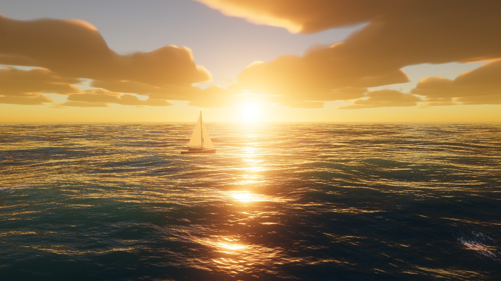
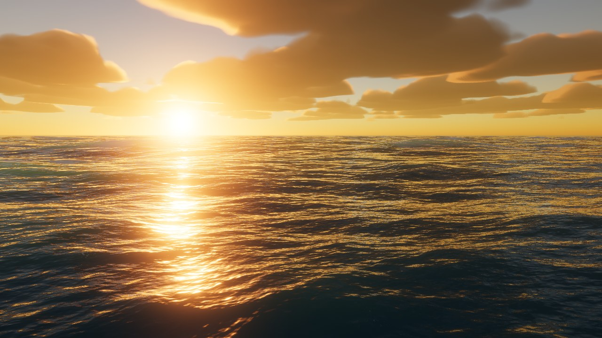
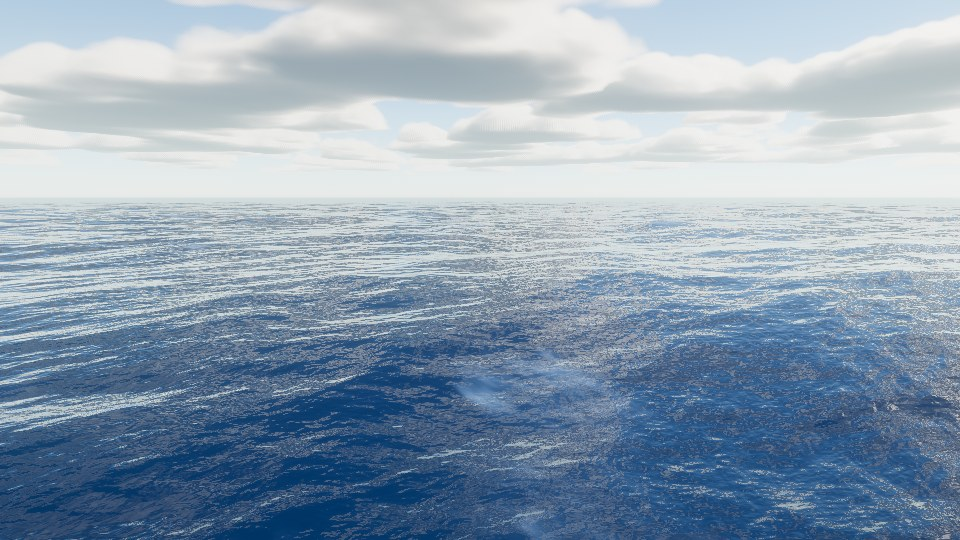
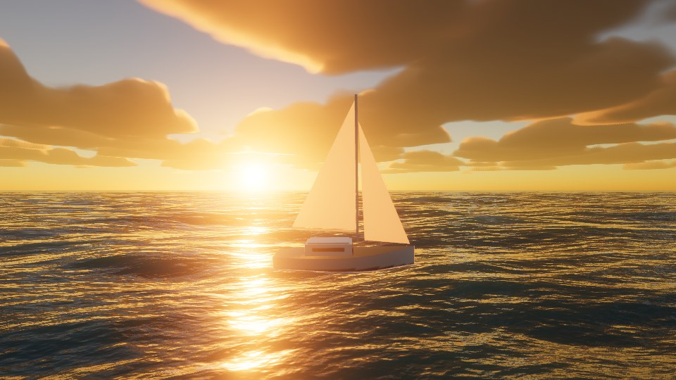
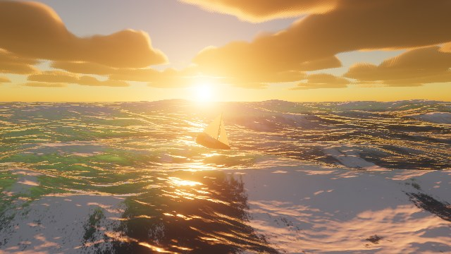

# WebGPU Ocean

ゲームエンジンも描画ライブラリも使わず、**ブラウザの WebGPU だけ**で動くリアルタイムの海です。
元記事のリポジトリ（MIT）のコードは参照せず、記事に書かれた機能リストだけを仕様として一から実装しました。



| 強風 (14 m/s) の白波 | 昼の太陽 | 波に揺れる船 |
|---|---|---|
|  |  |  |

## 動かし方

WebGPU 対応ブラウザ（Chrome / Edge 113 以降など）で `index.html` を開きます。ES Modules を使うので静的サーバ経由で開いてください。

```sh
python3 -m http.server 8000
# → http://localhost:8000/
```

Windows なら、何もインストールせずに `start.bat` をダブルクリックするだけで起動できます（PowerShell の小さなサーバー `serve.ps1` を使います。git があれば最新版への更新もします）。

ビルド工程も依存パッケージもありません（GitHub Pages などにそのまま置けます）。

### 新しい機能が出ないとき

⚙️ パネルの一番下にバージョン（例: `v4 · 船の物理`）が出ます。古い表示のままなら、次を試してください。

- **GitHub Pages で見ている:** ブラウザが古いファイルを最大 10 分ほどキャッシュします。`Ctrl+Shift+R`（Mac は `Cmd+Shift+R`）で強制再読み込みしてください。push 直後は Pages の更新に 1〜2 分かかることもあります。
- **自分の PC で動かしている:** `git pull` で最新にしてから、サーバーを立て直して強制再読み込みしてください。


WebGPU 対応ブラウザなら PC と同じページがそのまま動きます。

| 端末 | ブラウザ |
|---|---|
| PC | Chrome / Edge 113 以降 |
| Android | Chrome 121 以降（Android 12+） |
| iPhone / iPad | iOS 26 以降の Safari |

スマホからは `localhost` に届かないので、公開 URL が必要です。GitHub Pages ならリポジトリの
**Settings → Pages → Build and deployment → Source: Deploy from a branch** で、このブランチの `/ (root)` を選ぶだけです。
数分後に `https://neko811nya-stack.github.io/mytestopenAIFM/` で開けます。

### 画質（⚙️ → 画質）

右上の ⚙️ で設定パネルを開閉します。一番上の **画質** スライダーで「ライト（スマホ向け）」から「最高（PC向け）」まで 5 段階に切り替えられ、選んだ値はブラウザに保存されます。初期値は、タッチ端末なら「ライト」、PC なら「最高」です。

| 画質 | 解像度上限 | MSAA | FFT | 海面メッシュ | 雲のステップ | 反射マップ | ブルーム |
|---|---|---|---|---|---|---|---|
| ライト | 0.75x | なし | 128² | 192² | 16 | 512×128 | なし |
| 低 | 1.0x | なし | 128² | 256² | 22 | 512×128 | あり |
| 中 | 1.0x | 4x | 256² | 320² | 26 | 768×192 | あり |
| 高 | 1.25x | 4x | 256² | 448² | 34 | 1024×256 | あり |
| 最高 | 1.5x | 4x | 256² | 512² | 40 | 1024×256 | あり |

解像度上限は CSS ピクセルあたりのデバイスピクセル数の上限です。スライダーを離した時点で GPU リソースを作り直します（URL では `?q=0`〜`4`）。

### 操作

| 操作 | キー |
|---|---|
| 移動 | `W` `A` `S` `D`（矢印キーも可） |
| 上昇 / 下降 | `Space` / `E`、`Q` / `C` |
| 加速 | `Shift` |
| 視点 | ドラッグ（ダブルクリックでマウスロック） |
| 移動速度 | ホイール |
| 設定パネル | ⚙️ または `H` |
| 初期状態に戻す | ⚙️ → 「↺ デフォルトに戻す」（スライダーとカメラ位置。画質はそのまま） |
| スマホ | 左下のスティックで移動、右下の ▲▼ で上昇/下降、画面ドラッグで視点 |

右上のパネルで風速・風向・波の鋭さ・白波・太陽の高度と方位・雲量・露出・ブルーム・時間速度を変えられます。

URL パラメータで状態を固定できます（スクリーンショット比較用）。
例: `?t=30&cam=0,7,0,20,-4&sun=2,20&wind=14&waves=2&mass=3&speed=0&q=4&boat=0&ui=0&scale=1`（`panel=0/1` でパネルの開閉も固定）

## 記事の機能リストとの対応

| 記事の項目 | 実装 |
|---|---|
| 細かい波の揺れを計算で再現 | JONSWAP スペクトル + 方向分布 → GPU 上の逆 FFT（256²、3 カスケード）。波長約 7 cm〜数百 m を 1 フレームで合成 |
| 波頭に立つ白波 | 水平変位のヤコビアンで波頭の圧縮/折り返しを検出 → 減衰しながら残る泡バッファ + セル状ノイズでしきい値処理 |
| 夕日が水面に落とすきらめき | GGX スペキュラ（画素の大きさに応じて粗さを広げる）+ Karis 平均付きのブルーム |
| 雲が流れる夕焼け空 | Rayleigh/Mie/オゾンの大気散乱 LUT + 2D カバレッジ + 3D Worley 侵食のボリューム雲（風で流れる） |
| WASD で自由に飛べるカメラ | 慣性付きフライカメラ（`src/camera.js`） |
| （追加）浮かぶ船 | コードで組み立てた帆船を GPU 上の剛体として計算（下の「船の物理」） |
| エンジン・ライブラリ不使用 | 依存ゼロ。行列計算も自前（`src/math.js`） |

## 船の物理

⚙️ →「船」で、表示・重さ（1〜12 t）・速度（0 で停泊、それ以上で大きな円を描いて帆走）を変えられます。傾きと浸水の割合も表示されます。
沈めたいときは「海」の **風速** と **波の高さ ×** を上げてください。波の高さは、波長ごと海を大きくした上で少し急にします（大きなうねりほどゆっくり進みます）。



- 船体を 24 本の柱に分け、毎フレーム、その下の実際の波の高さと水の動きを GPU 上で読み取ります。
- 各柱にアルキメデスの浮力（沈んだ体積 × 海水の重さ）と、動く水に対する抵抗をかけます。抵抗は縦方向は小さく、横方向はキールの分だけ大きくしています。
- 加えて重力（バラストで重心は低め）と帆への風圧をかけ、位置と姿勢（クォータニオン）を 1 フレーム 6 分割で積分します。
- 船の下で波が崩れている（水面が折り返している）と、崩れた波頭が舷側を叩いて船を押し倒し、水が甲板に流れ込みます。
- 甲板を越えた水は船内に溜まって重さになり、転覆すると一気に浸水します。満水になると沈み、海底で数秒待ったあと新しい船が出ます（「船を戻す」ですぐ戻すこともできます）。
- 帆走中は船首波とケルビン航跡（約 19.5° の V 字）、船首が波に突っ込むとしぶきの泡が出ます。

描画なしの検証（`tools/boatsim.html`）での結果:

| 条件 | 結果 |
|---|---|
| 風 9 m/s・波 ×1 | 傾き 5〜20°、浸水なし |
| 風 20 m/s・波 ×1 | 45〜55° まで倒されては起き上がる |
| 風 16 m/s・波 ×2 | 40° 前後まで何度も倒されるが耐える |
| 風 22 m/s・波 ×3 | 上下 ±10 m。崩れ波ですぐ転覆（134°）、2 度目の大波で約 25 秒で満水、約 29 秒で沈没 → 新しい船 |
| 速度 6 kn | 約 5.5 kn で円を描いて帆走 |

## 仕組み

```
毎フレーム
 ├─ compute: 海洋シミュレーション (src/ocean.js)
 │    h(k,t) の時間発展 → Stockham 逆 FFT 16 パス → 変位/微分テクスチャ + 泡 → ミップ生成
 ├─ compute: 空 (src/sky.js)
 │    大気散乱 LUT (256×128) → 雲込みの反射用環境マップ (1024×256) + 太陽の雲による遮蔽率
 ├─ render (4x MSAA, HDR, reversed-Z)
 │    海面: カメラ中心の極座標メッシュ、頂点シェーダで変位、フラグメントで法線/反射/スペキュラ/SSS/白波/霞
 │    空:   大気 LUT + 太陽 + ボリューム雲 (深度が空いている画素だけ)
 └─ post (src/post.js): ブルーム (13 タップ縮小 / テント拡大) → ACES トーンマップ → sRGB
```

- **3 カスケード**（256 m / 48 m / 9 m）が波数帯を分担するので同じ波長を二重に数えません。分散関係を `2π/600s` で量子化しているので、600 秒で継ぎ目なくループします。
- 波高はスペクトルから物理的に決まります。GPU から読み戻した値は、風速 9 m/s で有義波高 ≈ 2.1 m、15 m/s で ≈ 3.5 m（`tools/simstats.html`）。
- 海面メッシュは同心リング（513×513 頂点）で、外側ほど間隔が指数的に広がります。頂点の間隔に合わせたミップレベルで変位をサンプリングするので、遠くの波がちらつきません。

## 「撮る係」と「直す係」のループ

記事にあった「Claude が画面を撮り、別の係が批評して直す」流れは、ヘッドレス Chromium（SwiftShader の WebGPU）で再現できます。

```sh
python3 -m http.server 8000 &
node tools/shot.mjs out.png "t=30&ui=0&cam=0,7,0,120,12" 4
MOBILE=1 node tools/shot.mjs phone.png "t=0&panel=1" 3   # スマホ（タッチ・DPR 3・390×844）をエミュレート
```

今回の開発でも、撮影 → 批評 → 修正を十数回まわしました。主な修正は次のとおりです。

1. 露出が約 6 倍高く画面が真っ白 → 露出の既定値と大気の多重散乱項を調整
2. 雲がほぼ見えない → カバレッジしきい値を修正
3. 雲に縦の筋とゴースト → 2D ノイズを厚みのある層に押し出していたのが原因。3D Worley 侵食とドーム状の高さしきい値に変更し、距離に応じた LOD も追加
4. 強風でも白波が出ない → GPU から読み戻して確認したところ、ヤコビアンの最小値が 0.57 前後で、しきい値 0.45 に一度も届いていなかった → しきい値を再調整
5. 白波が丸い点やぼやけた染みになる → 大きい波のカスケードを重視し、風下方向に伸ばした模様、セル状ノイズのしきい値処理、Lambert 照明に変更
6. 太陽が雲に隠れてきらめきが弱い → 地平線に向かって雲を薄くし、夕日が雲の下に覗く構図に

## ファイル構成

```
index.html          UI とエントリポイント
src/main.js         初期化・メインループ・UI
src/ocean.js        FFT 海洋シミュレーション (compute)
src/oceanRender.js  海面メッシュとシェーディング
src/sky.js          大気散乱・雲・環境マップ
src/post.js         ブルーム・トーンマップ
src/camera.js       フライカメラ
src/boat.js         船のメッシュ生成・浮力 (compute)・描画
src/math.js         行列ユーティリティ
src/common.js       共通 WGSL / バインドグループ補助
tools/shot.mjs      ヘッドレス撮影スクリプト
tools/simstats.html シミュレーション統計の読み戻し (デバッグ用)
tools/boatsim.html  描画なしで船の物理を走らせて軌跡を表示 (デバッグ用)
```

## 既知の制限と今後

- 重い場合は ⚙️ の画質を下げてください。雲を半解像度で描いて TAA で積み重ねると、ライトでも雲の段差を減らせる余地があります。
- 泡はシミュレーション格子上で減衰するだけで、流れに沿った移流はしていません。
- 水面の反射は空だけなので、船は水面に映りません（画面空間反射か、反転描画を足すと対応できます）。
- 船は波から力を受けますが、波を押しのけはしません（FFT の海は一方向の結合）。船首波・航跡・しぶきは泡の表現です。
- 遠方では 256 m タイルの繰り返しがわずかに見えることがあります（4 つ目のカスケードか、マクロなノイズ変調で対処可能）。
- 実 GPU・スマホ実機での fps はこの環境では計測できていません（検証はソフトウェア描画の SwiftShader とスマホのエミュレーションで実施）。
